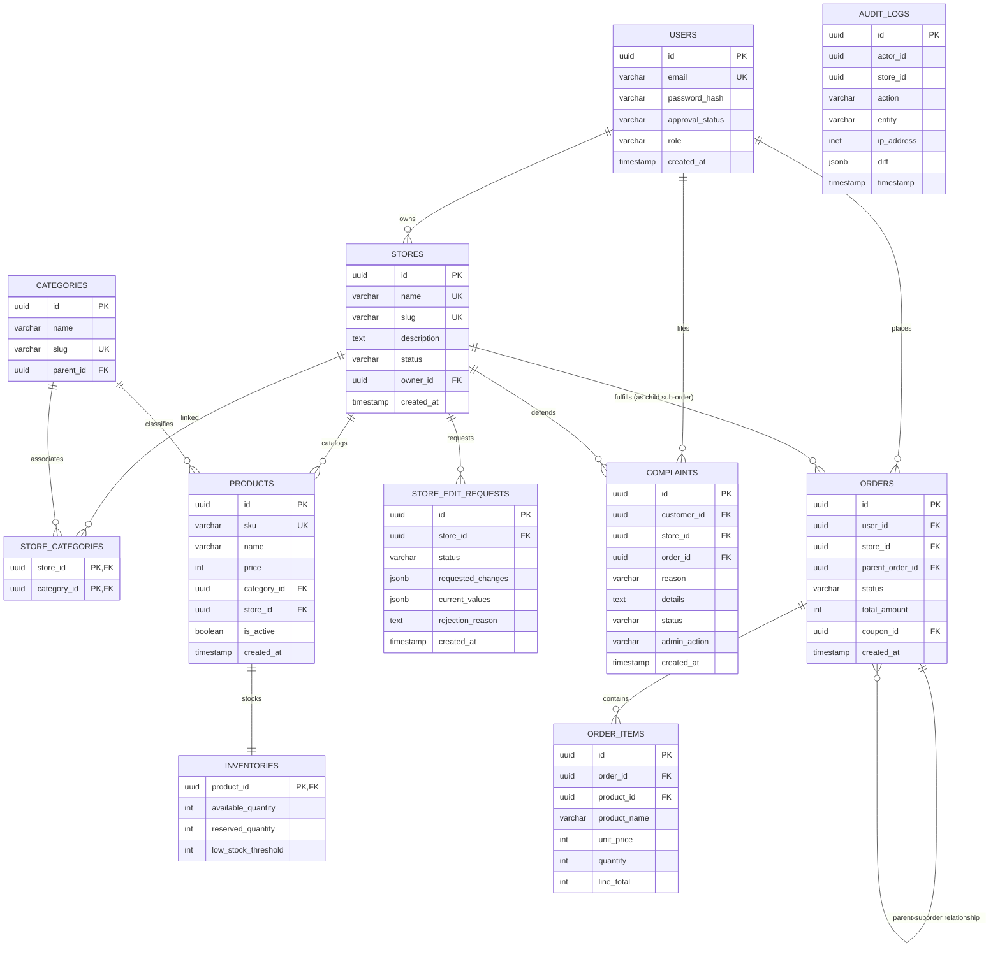

# Architecture: Database Schema & ERD

## 1. Relational Database Design (PostgreSQL 16)

The schema enforces data integrity through foreign keys, check constraints, unique indexes, and audit timestamps.

