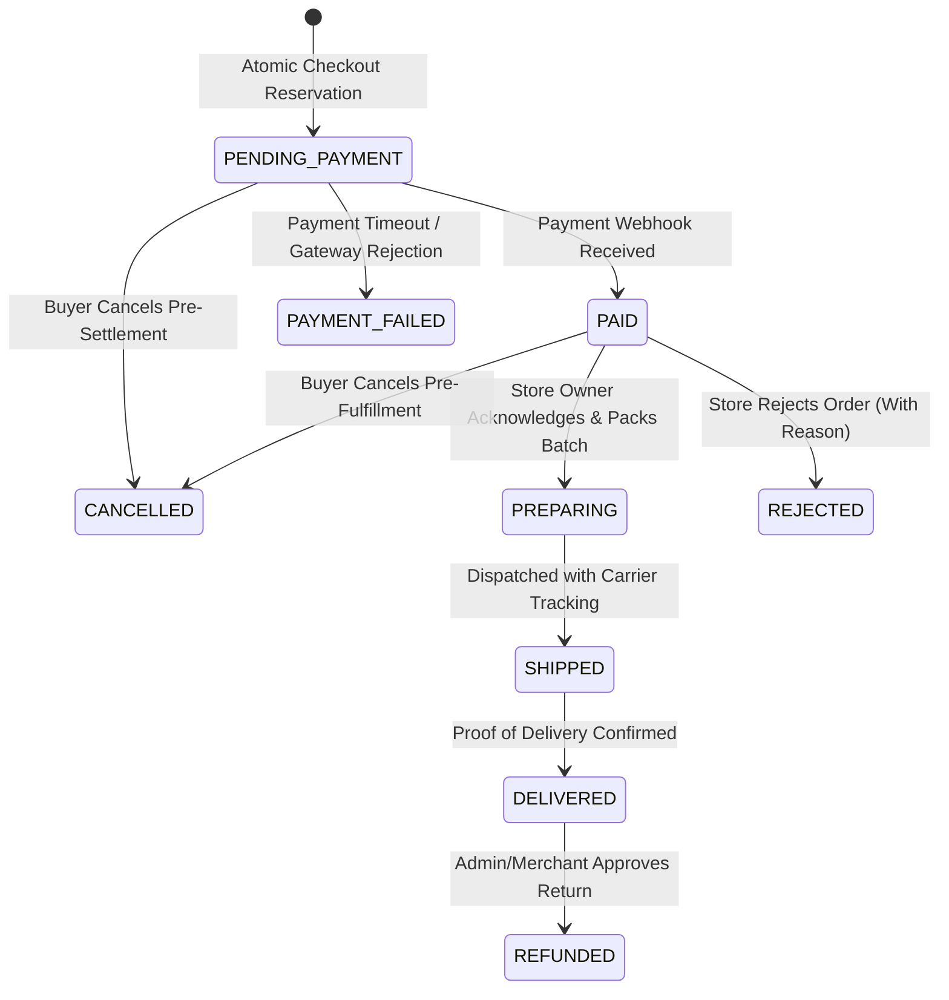

# Architecture: Domain Model & State Machines

## 1. Domain Aggregates & Invariants

### 1.1 Store Aggregate (`Store`)
- **Invariants:**
  - Must have a unique `slug` derived from its name.
  - Must belong to an approved owner (`UserRole.OWNER`).
  - Status transitions: `PENDING` → `ACTIVE` ↔ `SUSPENDED`.
  - When `SUSPENDED`, all products belonging to the store are excluded from customer carts and cannot receive checkout reservations.

### 1.2 Store Edit Request Aggregate (`StoreEditRequest`)
- **Invariants:**
  - An owner can submit changes to store profile, name, banner, or theme colors.
  - Finite State Machine: `PENDING` → `APPROVED` (applies changes) or `REJECTED` (with required reason).
  - Can only transition to `RESUBMITTED` if currently in `REJECTED` state. Resubmissions while `PENDING` or `APPROVED` are strictly disallowed.

### 1.3 Order Aggregate (`Order`)
- **Invariants:**
  - Parent/child relational tree: A multi-store order creates a composite parent record and dedicated child records for each independent store.
  - Money calculations are stored strictly as integers in minor units (e.g., $10.00 = 1000).
  - Order lines capture an immutable snapshot of product price, title, and quantity at the exact instant of reservation.
  - State Machine:
    - `PENDING_PAYMENT` → `PAID` → `PREPARING` → `SHIPPED` → `DELIVERED`.
    - Terminal states: `CANCELLED` (pre-dispatch), `REJECTED` (by merchant with reason), `REFUNDED` (post-delivery dispute).

### 1.4 Inventory Aggregate (`Inventory`)
- **Invariants:**
  - `available_quantity` cannot be less than 0 under any circumstance.
  - Deductions acquire a pessimistic row-level lock (`SELECT ... FOR UPDATE`) to guarantee serialization.

---

## 2. Order Lifecycle State Diagram

