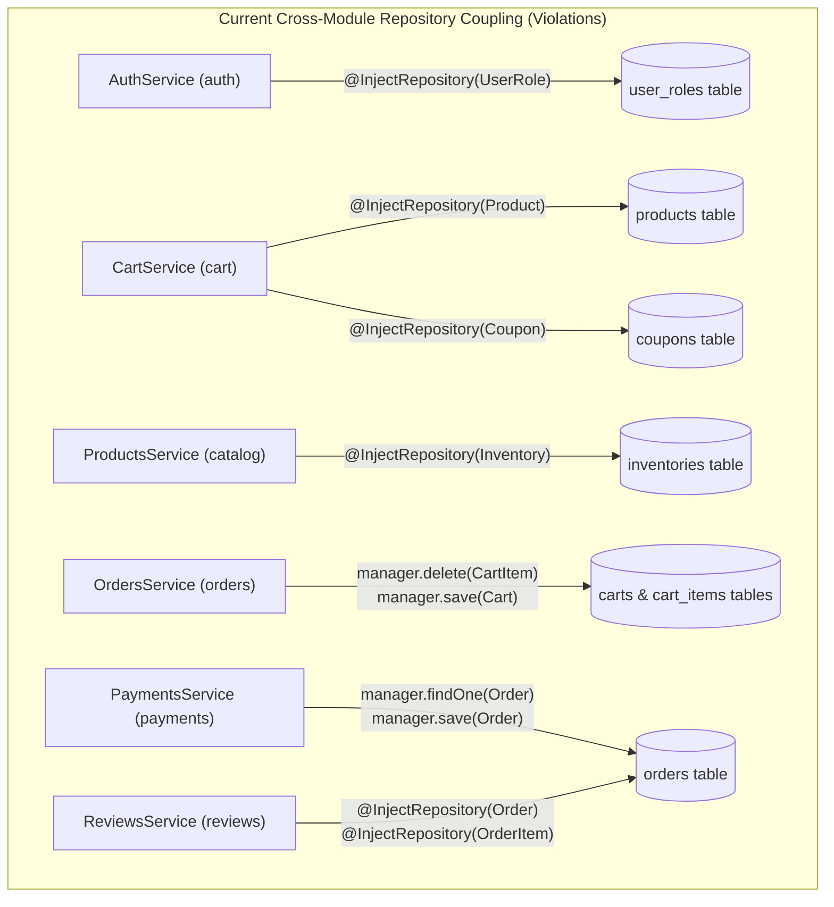
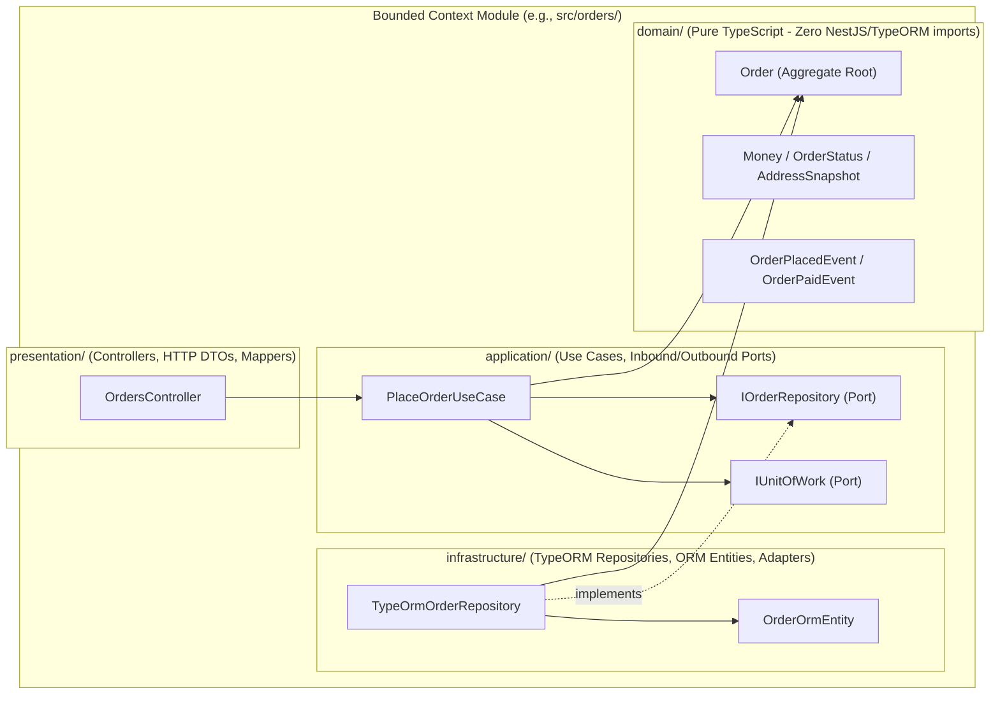

# 01 — Clean Architecture Audit & Refactoring Plan

> **Scope:** Full architectural evaluation of `src/` against Clean Architecture (Hexagonal / Ports & Adapters / DDD Tactical Patterns) and the project's own target specification in `docs/reports/02-design/architecture.md`.

---

## 1. Executive Verdict

**Is `src/` implemented using Clean Architecture?**
**No.** The current codebase is a **Transaction-Script / CRUD-oriented NestJS Modular Monolith** tightly coupled to TypeORM, PostgreSQL, Redis, and HTTP transport concerns.

While `docs/reports/02-design/architecture.md` specifies:
- Strict module boundaries where cross-module communication happens only via **exported Application Services** or **Domain Events**
- Encapsulated **Aggregate Roots** (`Order`, `Cart`, `Product`, `Inventory`, `User`, `Payment`)
- **Hexagonal / Ports & Adapters** separation for infrastructure (PostgreSQL, Redis, Payment Gateways, Notification Channels)

The actual implementation in `src/` has **zero separation** between Domain, Application, Infrastructure, and Presentation layers:
1. **No `domain/`, `application/`, `infrastructure/`, or `presentation/` directories exist** in any of the 13 modules.
2. **All 23 entities live in a single global `src/database/entities/` folder** as anemic TypeORM data structures with public mutable properties and zero domain logic.
3. **Every service directly injects TypeORM `Repository<Entity>` or `DataSource`**, mixes business rules with SQL/ORM queries, catches raw PostgreSQL driver error codes (`err?.code === '23505'`), and throws NestJS HTTP exceptions (`BadRequestException`, `NotFoundException`, `UnauthorizedException`) directly from business logic.
4. **Modules bypass each other's services and directly query or mutate other modules' database tables** (`CartService` querying `Product` and `Coupon` repositories; `OrdersService` deleting `CartItem` rows directly; `PaymentsService` updating `Order` status directly via `EntityManager` without invoking `OrdersService` or `InventoryService`).

---

## 2. Detailed Architectural Diagnosis of `src/`

### 2.1 Layering & Folder Structure Diagnosis (`src/` Overview)

| Current Directory | Current Contents | Clean Architecture Violations |
| :--- | :--- | :--- |
| `src/database/entities/` | 23 TypeORM `@Entity()` classes (`index.ts` barrel export) | Centralizes all persistence models globally. Every module imports database entities from `../database/entities`. Domain models do not exist independently of TypeORM decorators. |
| `src/common/` | `AllExceptionsFilter`, `TransformInterceptor`, `CorrelationIdMiddleware` | Contains only HTTP/Express concerns (`express`, `@nestjs/common`). No shared Domain primitives (`AggregateRoot`, `Entity`, `ValueObject`, `DomainEvent`, `Result`, `UnitOfWorkPort`). |
| `src/redis/` | `RedisModule`, `RedisService` | Directly exposes `ioredis` methods (`get`, `set`, `del`, `getClient()`) without an abstract `CachePort` or `TokenStorePort` interface. |
| `src/auth/` | `AuthController`, `AuthService`, Guards, Decorators | `AuthService` directly queries `Repository<UserRole>` (owned by `UsersModule`), directly calls `RedisService`, and embeds JWT signing/parsing alongside authentication policies. |
| `src/users/` | `UsersService`, `UsersModule` | Exposes raw TypeORM `User` persistence records (`relations: ['user_roles', 'user_roles.role', ...]`) directly to callers. |
| `src/catalog/` | `ProductsController`, `ProductsService`, `CategoriesController`, `CategoriesService` | `ProductsService` directly injects `Repository<Inventory>` (owned by `InventoryModule`) and creates `Inventory` records inside `ProductsService.create()`. |
| `src/inventory/` | `InventoryController`, `InventoryService` | Manages its own `DataSource.createQueryRunner()` transactions in isolation—cannot participate in an atomic Unit of Work with `OrdersService` or `ProductsService`. |
| `src/coupons/` | `CouponsController`, `CouponsService` | Anemic CRUD over `Repository<Coupon>`. Does not encapsulate coupon validity or usage-limit domain rules (which are leaked into `PricingService`). |
| `src/cart/` | `CartController`, `CartService`, `PricingService` | `CartService` directly injects `Repository<Product>` and `Repository<Coupon>`, bypassing `CatalogModule` and `CouponsModule`. `PricingService` operates on TypeORM entities and throws HTTP `BadRequestException`. |
| `src/orders/` | `OrdersController`, `OrdersService` | `OrdersService.checkout()` orchestrates persistence directly via `DataSource`, mutates `Cart` and deletes `CartItem` rows directly via `EntityManager`, and relies on PostgreSQL error code `'23505'` for idempotency. |
| `src/payments/` | `PaymentsController`, `PaymentsService` | `PaymentsService.processWebhook()` directly locks and updates `Order` rows (`manager.findOne(Order, ...)`, `manager.save(Order, order)`) instead of calling an `OrdersModule` use case, and completely forgets to call `InventoryService.deductInventory()` or `releaseInventory()`. |
| `src/shipping/` | `ShippingController`, `ShippingService` | Directly queries/mutates `Shipment` TypeORM entities; never notifies `OrdersModule` when a shipment is dispatched or delivered. |
| `src/reviews/` | `ReviewsController`, `ReviewsService` | Directly injects `Repository<Order>` and `Repository<OrderItem>` and builds SQL joins (`createQueryBuilder('orderItem').innerJoin('orderItem.order', 'order')`) against `OrdersModule` tables. |
| `src/notifications/` | `NotificationsService` | Mixes `@OnEvent()` listeners, `@Cron()` polling, TypeORM `Repository<NotificationOutbox>` queries, and simulated external email dispatch in a single class with no `NotificationSenderPort`. |
| `src/audit/` | `AuditService` | Injects `Repository<AuditLog>`, uses untyped `any`, and is never called anywhere in the application. |

---

### 2.2 Violation 1: Anemic Domain Model Coupled to TypeORM (`src/database/entities/`)

All 23 entities in `src/database/entities/` are pure persistence schemas decorated with `@Entity()`, `@Column()`, `@ManyToOne()`, and `@OneToMany()`. None of them contain constructors that enforce invariants, private state, or domain methods:

- **`Order` (`src/database/entities/order.entity.ts`)**:
  - `status: OrderStatus` is a public field mutated arbitrarily from outside (`order.status = OrderStatus.PAID` inside `PaymentsService`).
  - No state machine validation exists on `Order` (e.g., preventing a `PAID` or `SHIPPED` order from transitioning back to `CANCELLED` on a late `payment.failed` webhook).
  - Financial totals (`subtotal`, `discount_total`, `tax_total`, `shipping_total`, `total_amount`) are raw `number` columns (`decimal(12,2)` which TypeORM hydrates as `string` at runtime!) with no `Money` Value Object.
- **`Inventory` (`src/database/entities/inventory.entity.ts`)**:
  - `available_quantity` and `reserved_quantity` are public properties mutated in `InventoryService` procedural loops rather than through domain methods like `inventory.reserve(qty)`, `inventory.release(qty)`, `inventory.commitReservation(qty)`, or `inventory.adjust(delta)`.
- **`Coupon` (`src/database/entities/coupon.entity.ts`)**:
  - Validity rules (active flag, date window `starts_at` / `expires_at`, `usage_limit` vs `times_used`, discount calculation capped at subtotal) are scattered inside `PricingService.calculatePricing()` (`src/cart/pricing.service.ts:24-56`) instead of living on a `Coupon` domain entity.
- **`Cart` (`src/database/entities/cart.entity.ts`)**:
  - Item addition, quantity updates, and coupon attachment are implemented as direct `CartItem` repository mutations in `CartService` (`src/cart/cart.service.ts:46-138`) rather than aggregate root methods on `Cart`.

---

### 2.3 Violation 2: Cross-Module Boundary Violations (Bypassing Bounded Contexts)

Even as a Modular Monolith, `src/` violates its own architecture rules (`docs/reports/02-design/architecture.md:30-35`: *"Module A CANNOT directly query Module B's database tables or repositories"*).



| Violating File | Foreign Repository / Entity Accessed | Architectural Consequence |
| :--- | :--- | :--- |
| `src/auth/auth.module.ts:15` & `src/auth/auth.service.ts:24` | `@InjectRepository(UserRole)` | `AuthModule` reaches into `UsersModule`'s join table to assign default roles instead of calling `UsersService` / `UserRepositoryPort`. |
| `src/cart/cart.module.ts:10` & `src/cart/cart.service.ts:19-22` | `@InjectRepository(Coupon)`, `@InjectRepository(Product)` | `CartModule` queries `products` and `coupons` tables directly instead of using a Catalog or Coupon port/facade. |
| `src/catalog/catalog.module.ts:12` & `src/catalog/products.service.ts:16` | `@InjectRepository(Inventory)` | `CatalogModule` directly inserts rows into `inventories` (`src/catalog/products.service.ts:36-41`) instead of emitting a `ProductCreatedDomainEvent` or calling `InventoryModule`. |
| `src/orders/orders.service.ts:116-118` | `manager.delete(CartItem, ...)`, `manager.save(Cart, ...)` | `OrdersModule` directly wipes `carts` and `cart_items` rows in the database instead of delegating to `CartModule` or publishing an `OrderPlacedDomainEvent`. |
| `src/payments/payments.service.ts:57-91` | `manager.findOne(Order, ...)`, `manager.save(Order, ...)` | `PaymentsModule` directly mutates the `orders` table, completely bypassing `OrdersService` and `InventoryService` (leaving reserved stock permanently stuck!). |
| `src/reviews/reviews.module.ts:10` & `src/reviews/reviews.service.ts:14-17` | `@InjectRepository(Order)`, `@InjectRepository(OrderItem)` | `ReviewsModule` writes raw SQL joins against `orders` and `order_items` to verify purchase history instead of calling an `OrderQueryPort` / `VerifiedPurchasePort`. |

---

### 2.4 Violation 3: Infrastructure & Transport Leakage into Application/Domain Logic

1. **HTTP Exceptions inside Core Business Logic**:
   - `PricingService` (`src/cart/pricing.service.ts:28-38`) throws HTTP `BadRequestException` (`@nestjs/common`) when a coupon is expired or exceeds usage limits. If `PricingService` is called from a CLI, background worker, or gRPC/GraphQL adapter, it is coupled to HTTP status codes.
   - All 13 services throw `NotFoundException`, `BadRequestException`, `ConflictException`, `UnauthorizedException` directly instead of returning typed Domain Errors (e.g., `InsufficientStockError`, `CouponExpiredError`, `InvalidOrderStateTransitionError`) mapped by an HTTP Exception Filter in the Presentation layer.
2. **PostgreSQL Driver Error Codes in Application Services**:
   - `OrdersService.checkout()` (`src/orders/orders.service.ts:127`) and `PaymentsService.processWebhook()` (`src/payments/payments.service.ts:102`) inspect `err?.code === '23505'` (PostgreSQL `unique_violation`) directly inside service orchestration logic.
3. **Split Transaction Boundaries (Missing Unit of Work)**:
   - In `OrdersService.checkout()` (`src/orders/orders.service.ts:62-75`), `this.inventoryService.reserveInventory(...)` opens and commits its own database transaction **before** `OrdersService` opens a second transaction (`src/orders/orders.service.ts:78`) to insert the `Order` and `IdempotencyKey`. If the idempotency check fails or order persistence throws, the first transaction has already committed unless manual compensating logic succeeds.

---

## 3. Target Clean Architecture Blueprint

### 3.1 Concentric Layer Dependency Rule

All dependencies must point strictly **inward**:
$$\text{Presentation / Infrastructure} \longrightarrow \text{Application (Use Cases & Ports)} \longrightarrow \text{Domain (Entities, Value Objects, Domain Events)}$$



### 3.2 Standardized Directory Structure

```text
src/
├── common/
│   ├── domain/                        # Pure TS base classes (ZERO NestJS/TypeORM imports)
│   │   ├── aggregate-root.base.ts
│   │   ├── entity.base.ts
│   │   ├── value-object.base.ts
│   │   ├── domain-event.base.ts
│   │   ├── domain-exception.base.ts
│   │   └── money.vo.ts
│   ├── application/                   # Shared Application Ports
│   │   ├── unit-of-work.port.ts
│   │   ├── cache.port.ts
│   │   └── event-bus.port.ts
│   ├── infrastructure/                # Shared Infrastructure Adapters
│   │   ├── persistence/
│   │   │   └── typeorm-unit-of-work.ts
│   │   └── event-bus/
│   │       └── nest-event-bus.adapter.ts
│   └── presentation/                  # Filters, Interceptors, Middlewares, Pipes
│       ├── filters/
│       │   └── all-exceptions.filter.ts  # Maps DomainException -> HTTP Status
│       ├── interceptors/
│       └── middlewares/
│
├── orders/                            # Example Bounded Context Module
│   ├── domain/
│   │   ├── entities/
│   │   │   ├── order.aggregate.ts     # Rich domain logic: markPaid(), cancel(), ship(), deliver()
│   │   │   └── order-item.entity.ts
│   │   ├── value-objects/
│   │   │   ├── order-status.vo.ts
│   │   │   └── address-snapshot.vo.ts
│   │   ├── events/
│   │   │   ├── order-placed.event.ts
│   │   │   ├── order-paid.event.ts
│   │   │   └── order-cancelled.event.ts
│   │   ├── exceptions/
│   │   │   └── invalid-order-transition.exception.ts
│   │   └── ports/
│   │       └── order.repository.port.ts
│   ├── application/
│   │   ├── use-cases/
│   │   │   ├── checkout-order.use-case.ts
│   │   │   ├── mark-order-paid.use-case.ts
│   │   │   ├── cancel-order.use-case.ts
│   │   │   └── get-user-orders.use-case.ts
│   │   └── ports/
│   │       └── verified-purchase.query.port.ts
│   ├── infrastructure/
│   │   ├── persistence/
│   │   │   ├── typeorm-order.repository.ts
│   │   │   └── order.mapper.ts        # Maps OrderOrmEntity <-> Order Aggregate
│   │   └── queries/
│   │       └── typeorm-verified-purchase.query.ts
│   ├── presentation/
│   │   ├── orders.controller.ts
│   │   └── dto/
│   │       └── checkout.dto.ts
│   └── orders.module.ts
```

*(Note: During incremental migration, existing `src/database/entities/*.entity.ts` classes serve as the TypeORM Persistence Entities mapped by `*.mapper.ts` in each module's `infrastructure/persistence/` layer so database migrations remain 100% compatible.)*

---

## 4. Before vs. After Code Examples

### 4.1 Rich Domain Aggregate (`Order`) vs. Anemic Persistence Entity

**BEFORE (`src/payments/payments.service.ts:68-89` — Anemic procedural mutation):**
```typescript
if (event_type === 'payment.succeeded') {
  payment.status = PaymentStatus.CAPTURED;
  order.status = OrderStatus.PAID; // Mutates public field directly; ignores current status & inventory!
  await manager.save(Payment, payment);
  await manager.save(Order, order);
} else if (event_type === 'payment.failed') {
  payment.status = PaymentStatus.FAILED;
  order.status = OrderStatus.CANCELLED; // BUG: Overwrites PAID order if webhook arrives out-of-order!
  await manager.save(Payment, payment);
  await manager.save(Order, order);
}
```

**AFTER (`src/orders/domain/entities/order.aggregate.ts` — Rich Aggregate Root):**
```typescript
export class OrderAggregate extends AggregateRoot<string> {
  private _status: OrderStatus;
  private readonly _items: OrderItemDomainEntity[];

  public markAsPaid(paymentId: string): void {
    if (this._status === OrderStatus.PAID) {
      return; // Idempotent no-op
    }
    if (this._status !== OrderStatus.PENDING && this._status !== OrderStatus.RESERVED) {
      throw new InvalidOrderStateTransitionException(this.id, this._status, OrderStatus.PAID);
    }
    this._status = OrderStatus.PAID;
    this.addDomainEvent(
      new OrderPaidDomainEvent({
        orderId: this.id,
        userId: this.userId,
        paymentId,
        items: this._items.map((i) => ({ productId: i.productId, quantity: i.quantity })),
      }),
    );
  }

  public cancelDueToPaymentFailure(reason: string): void {
    if (this._status === OrderStatus.PAID || this._status === OrderStatus.SHIPPED || this._status === OrderStatus.DELIVERED) {
      throw new InvalidOrderStateTransitionException(this.id, this._status, OrderStatus.CANCELLED);
    }
    if (this._status === OrderStatus.CANCELLED) {
      return;
    }
    this._status = OrderStatus.CANCELLED;
    this.addDomainEvent(
      new OrderCancelledDomainEvent({
        orderId: this.id,
        userId: this.userId,
        reason,
        items: this._items.map((i) => ({ productId: i.productId, quantity: i.quantity })),
      }),
    );
  }
}
```

### 4.2 Decoupled Cross-Module Communication via Ports & Domain Events

| Cross-Module Flow | Current Coupled Implementation | Target Clean Architecture Mechanism |
| :--- | :--- | :--- |
| **Product Creation -> Inventory Initialization** | `ProductsService` injects `@InjectRepository(Inventory)` | `CreateProductUseCase` calls `IInventoryProvisioningPort.initializeStock(productId, qty)` exported by `InventoryModule` inside a shared `IUnitOfWork`. |
| **Cart Validation -> Product & Coupon Lookup** | `CartService` injects `@InjectRepository(Product)` and `@InjectRepository(Coupon)` | `CartModule` uses `ICatalogProductReaderPort` (implemented by `CatalogModule`) and `ICouponEvaluatorPort` (implemented by `CouponsModule`). |
| **Checkout -> Reserve Stock + Create Order + Clear Cart + Increment Coupon** | `OrdersService` calls `InventoryService` in a separate transaction, directly deletes `CartItem` rows, ignores coupon usage count | `CheckoutOrderUseCase` executes inside a single `IUnitOfWork` transaction calling `IInventoryReservationPort`, `ICouponRedemptionPort`, `IOrderRepository`, and `ICartClearingPort`. |
| **Payment Succeeded/Failed -> Order & Inventory State** | `PaymentsService` directly mutates `Order` table and skips `InventoryService` | `ProcessPaymentWebhookUseCase` calls `OrdersModule`'s `ConfirmOrderPaymentUseCase` / `FailOrderPaymentUseCase`, which transitions `OrderAggregate`, calls `IInventoryReservationPort.commitReservation()` or `releaseReservation()`, and emits `OrderPaidDomainEvent` / `OrderCancelledDomainEvent`. |
| **Shipment Dispatched/Delivered -> Order Status** | `ShippingService` updates `Shipment` only; `Order.status` remains `PAID` forever | `ShippingModule` calls `OrdersModule`'s `MarkOrderShippedUseCase` / `MarkOrderDeliveredUseCase` (or emits `ShipmentDispatchedEvent` / `ShipmentDeliveredEvent`). |
| **Create Review -> Verify Customer Purchased Product** | `ReviewsService` queries `Order` and `OrderItem` repositories directly | `ReviewsModule` depends on `IVerifiedPurchasePort.hasUserPurchasedProduct(userId, productId)` implemented and exported by `OrdersModule`. |
