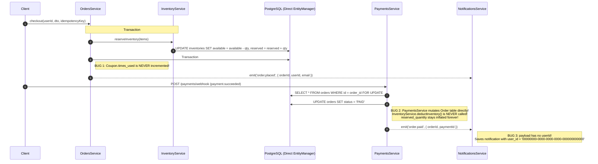
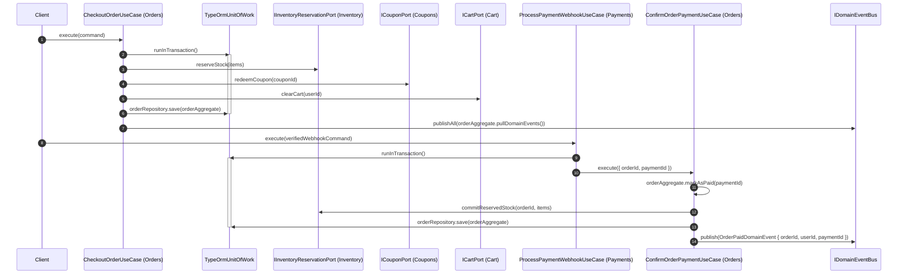

# 01 — Clean Architecture End-to-End Scenarios

> **Purpose:** Trace concrete runtime scenarios through `src/` to demonstrate how the current Transaction-Script / coupled architecture causes real data-integrity bugs, and how the target Clean Architecture (Use Cases, Rich Aggregates, Ports & Adapters, Unit of Work, Domain Events) resolves them.

---

## Scenario 1: Checkout -> Payment Webhook -> Inventory & Notification Lifecycle

### 1.1 Current Broken Architectural Flow (`src/` Today)



#### Architectural Failures Exposed in Scenario 1:
1. **Split Transactions (`src/orders/orders.service.ts:62-84`)**: `InventoryService.reserveInventory()` commits Transaction #1 before `OrdersService` checks the `IdempotencyKey` in Transaction #2 (`src/orders/orders.service.ts:79-83`). Although `OrdersService` tries to call `releaseInventory` in the `catch` block (`line 125`), if the Node.js process crashes between line 63 and line 78, inventory is permanently leaked with no order created.
2. **Bypassed Bounded Context (`src/payments/payments.service.ts:57-91`)**: `PaymentsService` directly runs `manager.save(Order, order)` instead of calling `OrdersModule`. Because `PaymentsService` does not know `OrdersModule`'s domain rules:
   - `InventoryService.deductInventory()` (`src/inventory/inventory.service.ts:130`) is **dead code**—never called anywhere in the codebase when an order is paid.
   - `InventoryService.releaseInventory()` (`src/inventory/inventory.service.ts:95`) is **never called** when `payment.failed` arrives, so cancelled orders permanently lock up `reserved_quantity`.
3. **Anemic Event Contract (`src/payments/payments.service.ts:96`)**: `PaymentsService` emits `'order.paid'` with `{ orderId, paymentId, correlationId }` (omitting `userId`), forcing `NotificationsService.handleOrderPaid()` (`src/notifications/notifications.service.ts:38`) to hardcode `user_id: '00000000-0000-0000-0000-000000000000'`.

---

### 1.2 Target Clean Architecture Flow



---

## Scenario 2: Out-of-Order Payment Webhooks (Anemic Entity vs. Rich Aggregate Root)

### 2.1 The Bug in Current Anemic Design
Payment gateways (like Stripe/Adyen) do not guarantee webhook delivery order. Suppose a customer's first card attempt fails (`evt_fail_1`), they immediately retry and succeed (`evt_success_2`), and `evt_fail_1` arrives at `/api/v1/payments/webhook` **2 seconds after** `evt_success_2`:

1. `evt_success_2` arrives first:
   - `src/payments/payments.service.ts:69`: `order.status = OrderStatus.PAID;`
2. `evt_fail_1` arrives second (different `event_id`, so idempotency check passes):
   - `src/payments/payments.service.ts:75`: `order.status = OrderStatus.CANCELLED;`
   - **Result:** A paid order that has already captured the customer's money is silently overwritten to `CANCELLED`!

### 2.2 Clean Architecture Domain Guard Verification
In the refactored `OrderAggregate` (`src/orders/domain/entities/order.aggregate.ts`), state transitions are protected by domain invariants:

```typescript
// Unit Test: src/orders/domain/entities/order.aggregate.spec.ts
describe('OrderAggregate State Machine', () => {
  it('refuses to cancel an order that is already PAID when a late payment.failed webhook arrives', () => {
    const order = OrderAggregate.createPending({
      id: 'ord-123',
      userId: 'usr-1',
      items: [{ productId: 'prod-1', quantity: 2, unitPrice: Money.fromDollars(50) }],
      shippingAddress: validAddressSnapshot,
    });

    order.markAsPaid('pay-success-2');
    expect(order.status).toBe(OrderStatus.PAID);

    expect(() => {
      order.cancelDueToPaymentFailure('pay-fail-1');
    }).toThrow(InvalidOrderStateTransitionException);

    expect(order.status).toBe(OrderStatus.PAID);
  });
});
```

---

## Scenario 3: Verified Purchase Review Creation Across Bounded Contexts

### 3.1 Current Violation (`src/reviews/reviews.service.ts:24-39`)
Currently, `ReviewsService` injects `@InjectRepository(Order)` and `@InjectRepository(OrderItem)` and writes internal SQL queries against `OrdersModule`'s tables:
```typescript
const hasPurchased = await this.orderItemRepository
  .createQueryBuilder('orderItem')
  .innerJoin('orderItem.order', 'order')
  .where('order.user_id = :userId', { userId })
  .andWhere('orderItem.product_id = :productId', { productId })
  .andWhere('order.status IN (:...statuses)', {
    statuses: [OrderStatus.PAID, OrderStatus.PROCESSING, OrderStatus.SHIPPED, OrderStatus.DELIVERED],
  })
  .getOne();
```
If `OrdersModule` changes its internal table structure or status representation, `ReviewsModule` breaks.

### 3.2 Clean Architecture Port & Adapter Verification
1. `OrdersModule` defines and exports `IVerifiedPurchaseQueryPort`:
   ```typescript
   export interface IVerifiedPurchaseQueryPort {
     hasUserPurchasedProduct(userId: string, productId: string): Promise<boolean>;
   }
   ```
2. `CreateReviewUseCase` in `ReviewsModule` depends only on `IVerifiedPurchaseQueryPort` and `IReviewRepository`:
   - Zero TypeORM imports in `CreateReviewUseCase`.
   - Unit testing `CreateReviewUseCase` requires only a 3-line mock of `IVerifiedPurchaseQueryPort` instead of mocking TypeORM's `createQueryBuilder().innerJoin().where().andWhere().getOne()` chain.

---

## Architectural Verification Checklist

Once the Clean Architecture refactoring is complete, verify compliance with the following automated checks:

1. **Zero ORM Imports in `domain/` and `application/`**:
   ```powershell
   Select-String -Path "src\*\domain\**\*.ts", "src\*\application\**\*.ts" -Pattern "typeorm"
   # Expected output: 0 matches
   ```
2. **Zero Cross-Module Entity Repository Injections**:
   - Each module's `infrastructure/persistence/` only registers TypeORM repositories for tables owned by its own bounded context.
3. **Unit Test Speed & Isolation**:
   - All `domain/` and `application/` unit tests run in `< 100ms` using in-memory fakes/mocks of repository ports without needing a live PostgreSQL or Redis instance.
